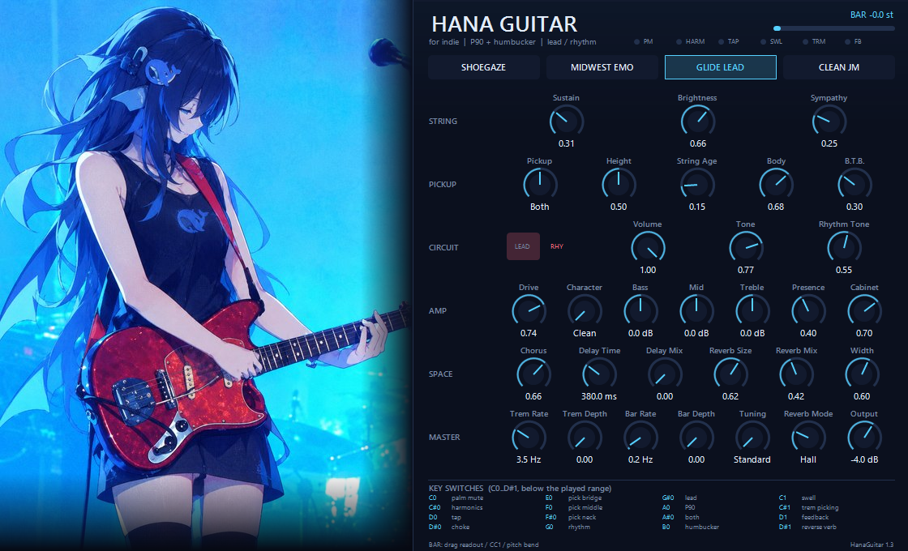

# HanaGuitar for indie 1.3

物理建模的 offset 电吉他音源（VST3）。六根波导弦、P90 琴颈 + 双线圈琴桥、
Jazzmaster 的 lead / rhythm 两套电路；摇把由 CC / 自动化 / 内置 LFO 驱动；
所有演奏技法都用键盘最低区（C0–D#1）的 keyswitch 切换，面板上没有技法旋钮。

> 原工程名是 *Offset JM*，1.3 起改名为 **HanaGuitar for indie**。插件 UID 也换了
> （`…5C1E3F88`），宿主会把它当成一个新插件，不会和旧版冲突。



---

## 1. 它是什么

不是采样器。每根弦是一条数字波导，拾音器是在线圈宽度上对弦位移取平均，
电路是电位器 + 电容的负载模型，摇把是弹簧-质量-阻尼系统。所以：

* 推弦/摇把时音高连续变化，不是采样移调；
* 换把位时拾音器的梳状陷波会跟着动；
* 音量关小会同时变暗（1M 电位器 + 电缆电容，没有 treble bleed）；
* rhythm 电路是另一套 50k + 0.02 µF 的 Netz，不是 EQ 预设。

**为两种音乐做**：shoegaze 的 glide guitar / 音墙，midwest emo 的 clean 点弦、
开放调弦、tapping。也覆盖 Sonic Youth 式噪音、Number Girl 式锐利扫弦的基本需求。

---

## 2. 安装

把 `dist\HanaGuitar.vst3` 复制到：

* `C:\Program Files\Common Files\VST3\`，或
* 你的 VST3 目录（例如 `D:\VST3\`）。

然后在 DAW 里重扫 VST3。FL Studio：Options → Manage plugins → 勾选 VST3 路径 →
Find more plugins。REAPER：Preferences → VST → 添加路径 → Re-scan。

**注意**：替换 `.vst3` 时宿主如果开着，它加载的还是旧模块，必须重启宿主。

---

## 3. 面板

左半屏是参考图（红色 offset 琴体、玳瑁护板、P90 + 双线圈）。右半屏按电路分组：

| 组 | 参数 |
|---|---|
| STRING | Sustain、Brightness、Sympathy |
| PICKUP | Pickup（P90 / Both / HB）、Height、String Age、Body、B.T.B. |
| CIRCUIT | Circuit（LEAD/RHY 开关）、Volume、Tone、Rhythm Tone |
| AMP | Drive、Character、Bass、Mid、Treble、Presence、Cabinet |
| SPACE | Chorus、Delay Time、Delay Mix、Reverb Size、Reverb Mix、Width |
| MASTER | Trem Rate、Trem Depth、Bar Rate、Bar Depth、Tuning、Reverb Mode、Output |

其他控件：

* 右上角 **`BAR` 读数**：鼠标上下拖 = 推摇把，双击归零；旁边是输出电平表。
* **PM / HARM / TAP / SWL / TRM / FB** 六个小灯：对应技法键是否按住。
* **预设**：SHOEGAZE / MIDWEST EMO / GLIDE LEAD / CLEAN JM。
* 离散参数（Pickup、Character、Tuning、Reverb Mode）：左键下一个、右键上一个、
  滚轮也行；连续参数拖动改值、双击复位、Shift+滚轮微调。

---

## 4. Keyswitch（C0–D#1，MIDI 24–39）

全部低于演奏音域（最低 E2 = 40），不会和音符冲突。

| 键 | 技法 | 类型 | 键 | 技法 | 类型 |
|---|---|---|---|---|---|
| C0 | 闷音 palm mute | 按住 | G0 | Rhythm 电路 | 切换 |
| C#0 | 泛音 harmonics | 按住 | G#0 | Lead 电路 | 切换 |
| D0 | 点弦 tap | 按住 | A0 | P90 | 切换 |
| D#0 | 断音 choke | 触发 | A#0 | 两拾音器 | 切换 |
| E0 | 拨弦位置：琴桥 | 按住 | B0 | 双线圈 | 切换 |
| F0 | 拨弦位置：中间 | 按住 | C1 | 音量 swell | 切换 |
| F#0 | 拨弦位置：琴颈 | 按住 | C#1 | 颤音拨弦 | 按住 |
| | | | D1 | 反馈 feedback | 按住 |
| | | | D#1 | 反向混响 | 切换 |

要点：

* **按住类**松开才失效；**切换类**只响应按下；**choke** 是一次性断音。
* keyswitch 不占弦、不发声。
* **Tapping**：按住 D0 时，同一根弦上先按的音还在响时，新音只改变有效弦长
  （hammer-on），抬指回到下面那个音（pull-off），全程不重新拨弦；每根弦最多
  记 4 个按音。不按 D0 时不做 legato，避免和弦里的相邻音被并到同一根弦。
* **泛音**用“在 12 品节点拨弦”（pick position 0.5）近似，不是逐个泛音建模。
* **Swell**：起音被抹掉、约 350 ms 渐开；也可以直接用 CC11 表情踏板。
* **Tremolo picking**：14 次/秒在同弦原位重拨，按住期间持续。
* **Feedback**：在上一音高叠一层慢漂移的谐波反馈，弦衰减后仍持续。

---

## 5. 摇把怎么控制

四种入口，可叠加：

| 方式 | 怎么给 | 行为 |
|---|---|---|
| 面板 `BAR` 读数 | 鼠标上下拖 / 双击归零 | 不经过宿主 |
| **CC1**（调制轮） | 0→127 | 0→全下潜（4 个半音）；回 0 弹簧回弹 |
| **Pitch Bend** | ±1 | 下潜 / 上提；松手自动回中 |
| **`Bar` 参数** | 宿主自动化（0→1） | 给不转发 CC 的宿主（FL 等） |
| **Bar Rate / Bar Depth** | MASTER 行两个旋钮 | 内置 LFO，自动晃动 |

* 范围固定 **4 个半音**，弹簧 **2.4 Hz**：CC 跳变会有过冲（“boing”），
  慢画曲线就是 shoegaze 的慢 glide。
* **LFO**：Rate 0.03–8 Hz，Depth 0 = 关、1 ≈ ±1 个半音。它叠加在 CC / 自动化
  之上，所以可以“手推着摇把 + LFO 微颤”。
* **CC11 不是摇把**（是音量表情），**CC64** 是延音踏板。

---

## 6. 两套电路与拾音器

**Lead**：两拾音器 → 1M 音量 → 1M 音色 + 0.033 µF。
音色关小是 ~6 kHz→600 Hz 的 treble cut；音量关小时电缆电容加载、高频一起变暗。

**Rhythm**：只有琴颈拾音器 → 50k + 0.02 µF，上限 1–2.6 kHz，电平低约 5 dB，
低频多一点。上弦枕旁的开关（面板 LEAD/RHY，或 G0/G#0）切换。

实测（E3，P90）：lead 峰值 −17.7 dB、1 kHz 以上能量 0.72%；rhythm −22.9 dB、
0.41%；音色全关 0.01%。

**拾音器**：

* 琴颈 **P90**：单宽线圈，谐振 ~4.6 kHz（Q 1.9），中频突出。
* 琴桥 **双线圈**：两个窄线圈串联、相距 10 mm，谐振 ~3.0 kHz，再经 4.3 kHz
  低通，输出高 3–4 dB。
* 中间档 0.52 混合两路。

**琴体**：两段固定腔体共振（240 Hz +5 dB、430 Hz +3 dB）叠加 8 个模态的
击弦余响，另加琴桥后弦段（B.T.B.）与轻微 saddle buzz。Body 默认 0.68，
开/关在 1 秒处约差 +2.5 dB。

---

## 7. 信号链

```
6 根波导弦
   ├─ P90（琴颈）      ─┐
   └─ 双线圈（琴桥）    ─┴─ 拾音器谐振 → 电路（lead / rhythm）
                              ├─ 空弦共鸣谐振器组
                              └─ 琴体 → 功放（Clean/OD/Fuzz/Muff）
                                    → Chorus → Delay → Reverb（含 Reverse）→ 输出
```

* 空弦共鸣是**谐振器组**而不是把弦信号注回弦环——后者会自激（旧版会在和弦
  衰减后突然爆音）。
* 功放有输入耦合、pre-emphasis、sag、四段 tone stack、1×12 cabinet、DC blocker，
  末级按 character 做输出 trim；主输出是软 ceiling，不会硬削。
* Reverb 是 4 线 FDN，5 种模式：Room / Hall / Plate / Gate / **Reverse**
  （实时近似：起音后 0.9 s 先涨后切）。

---

## 8. MIDI 行为

| 输入 | 作用 |
|---|---|
| Note On/Off | 拨弦 / 制音；力度 = 拨弦力度 |
| 和弦（同一 sample offset 的 ≥2 个 note-on） | 自动扫弦：9 ms/弦，方向交替 |
| Pitch Bend | 摇把（±1 → 下潜/上提） |
| Aftertouch / Poly Pressure | 再额外下潜最多 0.9 |
| CC1 | 摇把 |
| CC11 | 表情 / 音量踏板（swell） |
| CC64 | 延音踏板（note-off 不制音） |
| CC# | 无其他映射；DAW 里可把 CC 映射到任意参数 |

一个 MIDI 音符 = 一根弦；同弦重叠音在不按 D0 时重触发。

---

## 9. 参数（32 个旋钮 + Preset + Bar）

| id | 名称 | 范围 | 默认 |
|---|---|---|---|
| 0 | Sustain | 0–1（T60 0.5–20 s） | 0.65 |
| 1 | Brightness | 0–1 | 0.66 |
| 2 | Sympathy | 0–1 | 0.25 |
| 3 | Pickup | P90 / Both / HB | Both |
| 4 | Height | 0–1 | 0.50 |
| 5 | String Age | 0–1 | 0.15 |
| 6 | Body | 0–1 | 0.68 |
| 7 | B.T.B. | 0–1 | 0.30 |
| 8 | Circuit | Lead / Rhythm | Lead |
| 9 | Volume | 0–1 | 1.00 |
| 10 | Tone | 0–1 | 0.60 |
| 11 | Rhythm Tone | 0–1 | 0.55 |
| 12 | Drive | 0–1 | 0.08 |
| 13 | Character | Clean/OD/Fuzz/Muff | Clean |
| 14–16 | Bass / Mid / Treble | −12…+12 dB | 0 |
| 17 | Presence | 0–1 | 0.40 |
| 18 | Cabinet | 0–1 | 0.70 |
| 19 | Chorus | 0–1 | 0.10 |
| 20 | Delay Time | 20–1200 ms | 380 |
| 21 | Delay Mix | 0–1 | 0.18 |
| 22 | Reverb Size | 0–1 | 0.62 |
| 23 | Reverb Mix | 0–1 | 0.20 |
| 24 | Width | 0–1 | 0.60 |
| 25 | Trem Rate | 0.2–12 Hz | 3.5 |
| 26 | Trem Depth | 0–1 | 0 |
| 27 | Bar Rate | 0.03–8 Hz | 0.25 |
| 28 | Bar Depth | 0–1 | 0 |
| 29 | Tuning | Standard / Drop D / Eb / DADGAD / Open E / FACGCE / DAEAC#E | Standard |
| 30 | Reverb Mode | Room/Hall/Plate/Gate/Reverse | Hall |
| 31 | Output | −30…+12 dB | −4 |
| — | Preset | 4 个 | Clean JM |
| — | Bar | 0–1（自动化） | 0 |

调弦（绝对音高，低→高）：Standard `E A D G B E`、Drop D `D A D G B E`、
Eb `Eb Ab Db Gb Bb Eb`、DADGAD `D A D G A D`、Open E `E B E G# B E`、
FACGCE `F A C G C E`、DAEAC#E `D A E A C# E`。

---

## 10. 预设

| 预设 | 用途 |
|---|---|
| SHOEGAZE | fuzz + 大空间 + 慢摇把 LFO，和弦按着让摇把慢慢沉 |
| MIDWEST EMO | clean 偏亮、短衰减，适合点弦/分解 |
| GLIDE LEAD | 琴颈 P90 + 深 glide，摇把当乐器 |
| CLEAN JM | 参考音色（也是插件默认值） |

预设表在 `src\presets.h`，面板和离线渲染共用，避免“面板好听、导出不一样”。

---

## 11. 构建

需要：

* `g++`（工程用 `D:\tools\w64devkit\w64devkit\bin`）
* VST3 SDK（`D:\vst3work\sdk`）

改 `build.bat` 顶部的 `VK` / `SDK` 两个变量，然后：

```
build.bat
```

产物：

| 文件 | 说明 |
|---|---|
| `dist\HanaGuitar.vst3` | 插件（单文件，含面板图，~1.2 MB） |
| `build\jm_test.exe` | 引擎测试（68 项） |
| `build\host_test.exe` | VST3 宿主模拟（63 项，含面板回归） |
| `build\render_demo.exe` | 离线渲染 `demo\*.wav` |
| `build\panel.bmp` | 宿主模拟里实际画出的面板 |

调试用的探针（`tools\*_probe.cpp`、`tone_check`、`gain_probe`、`analyze.py`）都在
`tools\` 下，可以单独编译运行。

---

## 12. 验证

```
build\jm_test.exe      68 passed, 0 failed
build\host_test.exe    63 passed, 0 failed
```

覆盖内容：

* 音准（每根弦 ±1 cent）、摇把 −4 半音/回弹、Bar 参数、Bar LFO、弹簧过冲；
* P90/HB 谐振频率与电平、两套电路的亮度/电平差；
* swell、tremolo picking、feedback、sustain、legato（hammer-on/pull-off）；
* 反向混响有限性、块大小 1–1024 一致、采样率 8k–384k、参数极端值、确定性、复音；
* VST3 工厂/总线/参数/状态、keyswitch 不发声与切电路、CC 摇把；
* 面板：0×0 `onSize`、宿主把子窗口清零后只改容器尺寸、绘制/拖拽/开关/双击/卸载。

离线渲染 37 秒音频约 4 s（≈9× 实时，单线程 48 kHz）。

---

## 13. 故障排查

**面板黑屏 / 尺寸不对**

* 1.3 起每次绘制按真实 `GetClientRect` 取尺寸；每 50 ms 用 `GetParent()` 同步
  当前父窗口尺寸，宿主 reparent、刷新插件、只改容器不调 `onSize` 都能跟上。
* 还是黑：先**完全重启宿主**（替换 `.vst3` 后宿主仍用旧模块）。
* 看 `%TEMP%\HanaGuitar-ui.log`：会记录 `attached W H`、`adopt-parent`、
  `degenerate-client`、`gdiplus-failed`。
* FL 的插件包装器若开了 **Bridged / 独立进程**，自绘 UI 有时拿不到正确窗口，
  关掉再试。

**没有声音 / 技法键不工作**

* keyswitch 只在 C0–D#1；确认键盘/钢琴卷帘能发到这些音高（有些编辑器默认
  显示范围从 C1 开始）。
* 技法键不占弦：按住 C0 再弹才是闷音，单独按 C0 本来就没声音。

**CC 摇把没反应**

* FL 的 VST3 不转发 MIDI CC：用 `Bar` 参数自动化，或面板 `BAR` 读数直接拖。
* REAPER 等会送 legacy CC 的宿主，CC1 直接可用。

---

## 14. 已知限制

* 泛音是节点拨弦的近似，不是逐个泛音建模。
* 每弦独立调音未做（只有整把琴的 7 种调弦预设）。
* Prepared guitar、鼓棒/金属物件、Behind-the-Bridge 独立音区未做；琴体模型里
  只有 B.T.B. 共振。
* 反向混响是实时近似（起音后先涨后切），不是带前瞻的真反向。
* 面板只有 Windows（GDI+）；DSP 与 VST3 外壳是平台无关 C++。
* 一个 MIDI 音符 = 一根弦，同弦重叠音在不按 D0 时重触发。

---

## 15. 命名与沿革

| 版本 | 名称 | 主要变化 |
|---|---|---|
| 1.0 | Offset JM | 六弦波导 + 摇把弹簧 + 拾音器/琴体/功放 |
| 1.1 | Offset JM | 修卸载崩溃（参数双释放）、琴体双声道、调弦表、两套电路、P90+HB、UI 换图 |
| 1.2 | Offset JM | keyswitch 技法、CC 摇把、反向混响、反馈、swell、trem picking |
| 1.3 | **HanaGuitar for indie** | 更长延音/更慢弹簧、攻击性、空腔共振、tapping/legato 重做、Bar 参数 + LFO、面板尺寸/黑屏修复 |

插件身份：class `HanaGuitar for indie`，UID `0FF5E701-4A2C7B13-B8D94062-5C1E3F88`，
厂商 `HanaGuitar`。

---

## 16. 仓库结构 / 许可

`
src/            引擎与 DSP（平台无关 C++）
  params.h      参数表
  keyswitch.h   技法键映射
  dsp/          string / whammy / pickup / body / circuit / amp / space / feedback
vst3/           VST3 外壳、面板（GDI+）、内嵌面板图
tools/          测试、离线渲染、测量探针
docs/           技法参考（输入资料）
demo/           试听 wav、频谱图、面板截图
dist/           预编译的 HanaGuitar.vst3
build.bat       一键构建（g++ + VST3 SDK）
`

* 代码：MIT，见 LICENSE。
* st3/hero.jpg 是参考图，**不在 MIT 范围内**；二次分发请换成你自己的图，
  见 st3/ARTWORK.md。
* 构建需要 VST3 SDK（不随仓库分发）；uild.bat 顶部的 SDK 指向本地 SDK。
